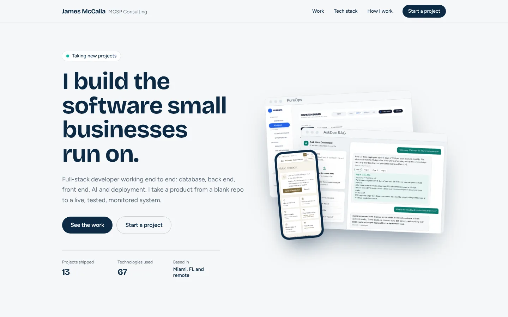
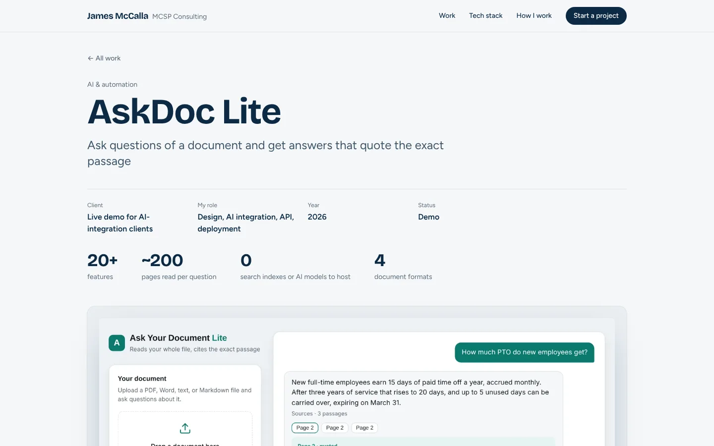
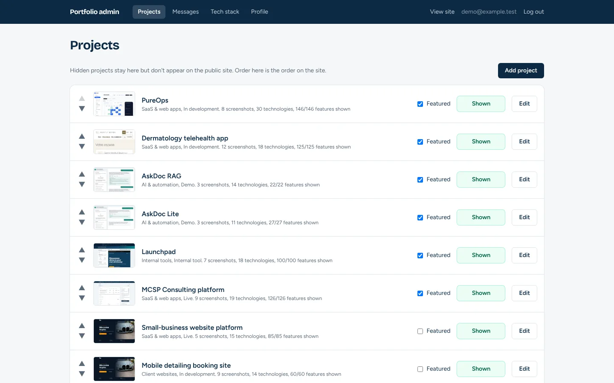
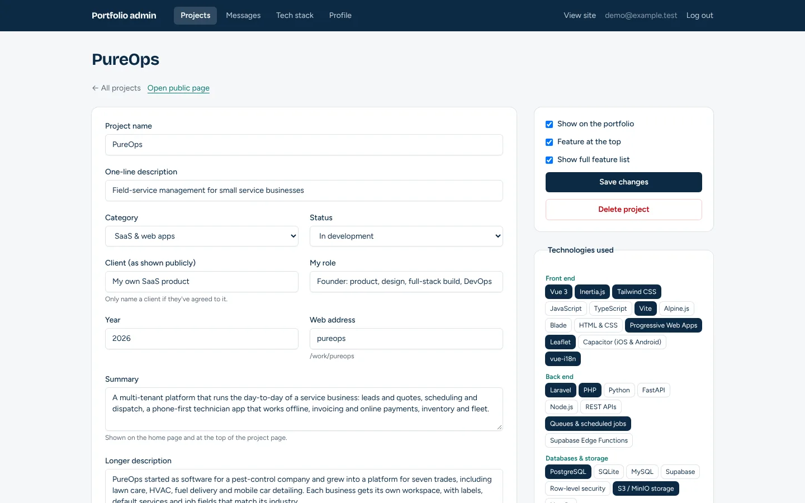
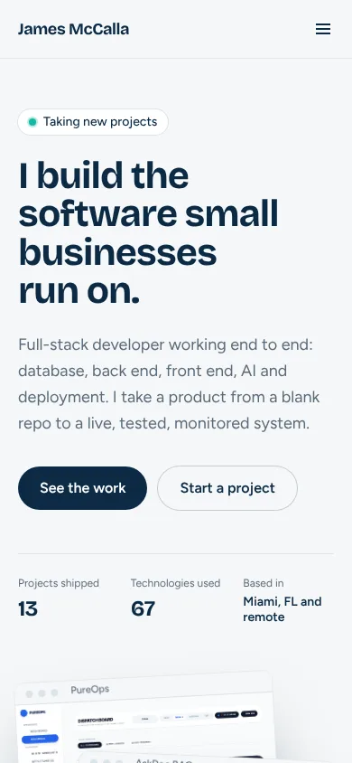

# Portfolio: James McCalla / MCSP Consulting

The site behind https://portfolio.mcspconsulting.com: a public portfolio of projects with screenshots, feature lists and tech stacks, plus a small admin for editing all of it.

| Home | Project page |
|---|---|
|  |  |

| Admin: projects (order, show/hide, featured) | Admin: edit a project |
|---|---|
|  |  |



## Stack

Laravel 13 · Inertia.js · Vue 3 (Composition API, `<script setup>`) · Tailwind CSS · Vite · Ziggy · PostgreSQL (SQLite works locally)

## What's in it

**Public site** (`resources/js/Pages/Home.vue`, `Project.vue`)
- Project grid with filters by category, a featured row, and per-project pages
- Screenshot galleries with desktop and phone frames (`Components/DeviceShot.vue`, `HeroStack.vue`)
- Feature lists grouped by area, tech-stack chips, contact form with honeypot and email notification
- Link previews (Open Graph images per project), `sitemap.xml` and `robots.txt`

**Admin** (`resources/js/Pages/Admin/`)
- Projects: create, edit, delete, show/hide, feature, reorder
- Screenshots: upload, caption, reorder, delete
- Feature lists: add, edit, group, reorder groups
- Tech stack and profile editing; contact messages inbox with read/unread
- Forms show server validation inline with `aria-invalid`, and network failures get a plain-language message

## Tests

49 PHPUnit feature tests (308 assertions) covering the public pages, the admin (auth required for every route, CRUD, ordering), contact handling (including when email delivery fails), feature lists and link previews.

```bash
composer install && npm install
cp .env.example .env && php artisan key:generate
php artisan test
```

## Run locally

```bash
touch database/database.sqlite   # set DB_CONNECTION=sqlite and DB_DATABASE to that path in .env
php artisan migrate --seed       # seeds all projects from public/images/projects/*/shots.json
php artisan portfolio:admin you@example.com   # create an admin login
composer run dev
```

## Deploy

Docker image (serversideup/php) built by Coolify from this repo; built front-end assets are committed in `public/build/` because the server has no Node. Uploads live on a persistent volume. See `DEPLOY.md`.

Built by James McCalla ([MCSP Consulting](https://mcspconsulting.com)).
